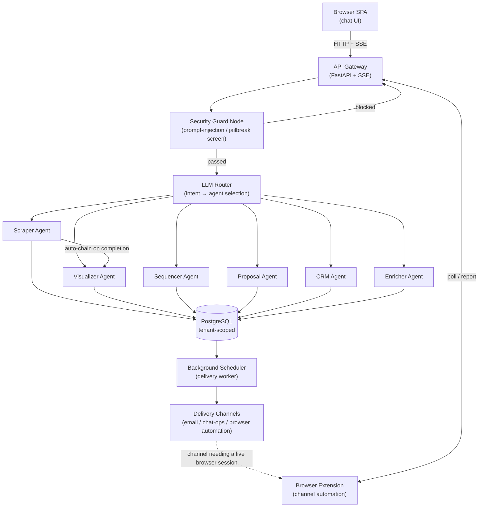
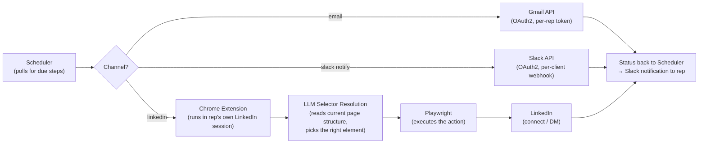

# ValueOrbit Agent Factory — AI-Powered B2B Outbound Sales Platform

> 🔒 **Confidentiality Notice**
> This is a **public technical showcase**. The production source code lives in a **private repository** (ValueOrbit AB) and is not included here. Internal URLs, credentials, and client-specific data have been generalized or removed. This document describes the system's architecture, engineering decisions, and complexity level as sole developer of the platform.

---

## Executive Summary & Business Problem

ValueOrbit is a Swedish B2B Revenue Operating System (RevOps SaaS) built to help sales teams identify, qualify, and engage prospects without juggling a dozen specialized tools. Within that platform, the **Agent Factory** automates the unglamorous half of outbound prospecting that otherwise eats a rep's day: manually reading LinkedIn engagement, guessing who's worth pursuing, drafting outreach and proposals from scratch, and remembering to follow up.

From a single chat interface, a rep can:

1. **Discover** — automatically scrape everyone who engaged with a LinkedIn post (likes, comments, reposts).
2. **Score** — have an LLM rank each person by role fit, engagement quality, and buying-intent signals.
3. **Visualize** — get an auto-generated analytics dashboard of the ranked leads.
4. **Sequence** — generate a multi-step, personalized outreach sequence (LinkedIn DM / email / call), with a human approval gate before anything goes out.
5. **Propose** — turn an open opportunity into a fully branded, personalized PowerPoint sales proposal from a single natural-language instruction — collapsing a task that normally takes a rep 2–4 hours of digging through the CRM and meeting notes into a few minutes.
6. **Deliver** — have approved outreach steps sent automatically on schedule, across the right channel for each one.

The core engineering problem isn't "call an LLM" — it's **orchestrating six specialized AI agents that share context, stay within their lane, respect strict per-customer data isolation, and hand off to each other without the user ever having to say which tool to use.** That orchestration layer — not any single agent — is what I designed and built as the platform's sole developer.

---

## Tech Stack

| Layer | Technology |
|---|---|
| **Frontend** | Vanilla JS/HTML/CSS single-page chat app (no framework) · Server-Sent Events for real-time streaming · Chrome Extension (Manifest V3) for browser-side automation |
| **Backend** | Python · FastAPI (async, SSE streaming) · LangGraph (agent state-machine orchestration) · LangChain · Google Gemini (LLM reasoning + structured routing) · Model Context Protocol (MCP) for tool integration |
| **Database** | PostgreSQL, dual-access pattern: `asyncpg` (async pool, main app) + `psycopg2` (sync, worker-thread pipeline) |
| **DevOps / Integrations** | OAuth2 (Google, Slack) · Scheduled background worker (polling job, decoupled from the web process) · Webhook-based delivery notifications · Environment-driven config |
| **Testing / QA** | Manual + scripted QA harnesses for document-rendering pipelines · structural validation via typed state schemas (`TypedDict`, Pydantic) enforced at every graph boundary |

**Scale:** ~19,500 lines of Python across 76 modules, plus ~10,000 lines of frontend/extension code, as sole developer.

---

## Architecture Diagram

---

## Technical Challenges & Solutions

### 1. Multi-agent orchestration without a keyword router
**Challenge:** Six specialized agents share one conversation. A naive keyword/intent-matching system breaks immediately on paraphrasing, typos, or multilingual input, and produces brittle "which button did the user mean" bugs.
**Solution:** A LangGraph `StateGraph` compiled once at startup, with a single LLM-based router that reasons about *intent* rather than matching keywords, and returns a structured decision (agent + reasoning + execution plan) at `temperature=0`. A small set of deterministic "flow guards" sit in front of the LLM router to keep short follow-up replies (like a bare date or "yes") attached to whichever multi-turn flow is already open, since those carry no intent on their own. One agent (the scraper) declares a conditional auto-chain into a second agent (the visualizer) purely through registry data — so extending the system with a new agent or a new hand-off never requires touching the graph-building code.

### 2. Hard tenant isolation in a shared, LLM-driven system
**Challenge:** The platform is multi-tenant — every customer's leads, sequences, and CRM data must be fully invisible to every other customer, even though all tenants share the same LLM prompts and the same running process. The two obvious failure modes are (a) tenant ID leaking into a prompt, where it could be echoed back or manipulated, and (b) tenant context getting lost across an async/thread boundary.
**Solution:** Tenant identity is resolved exactly once, at the request boundary, from a verified session token — never from the request body and never from user text — and held in a context-local variable for the lifetime of the request. Every database query is scoped by that value, and it is explicitly never interpolated into an LLM prompt. Because part of the pipeline runs synchronous work on a thread pool (which does not automatically inherit that context), a small dedicated helper re-binds the tenant context across the hop — a subtle bug class made structurally hard to reintroduce rather than something developers have to remember.

### 3. A dedicated security layer against prompt injection, ahead of any agent
**Challenge:** Any system that puts free-form user text in front of an LLM is exposed to prompt-injection and jailbreak attempts, and the risk compounds with six agents each capable of taking real actions (sending messages, writing to the CRM, generating documents).
**Solution:** Every message passes through a dedicated guard node — the fixed entry point of the graph — before any LLM reasoning happens. It normalizes the text (stripping invisible/zero-width characters, folding look-alike Unicode, decoding nested encodings) to defeat common obfuscation, then scores it against weighted pattern categories (instruction override, role hijacking, jailbreak framing, system-prompt extraction). Certain categories hard-block regardless of overall score; others contribute to a threshold. A blocked message never reaches any agent or LLM call. Detection rules are versioned so behavior changes stay auditable over time.

### 4. Decoupling "draft" from "deliver" across heterogeneous channels
**Challenge:** An approved outreach sequence has steps on different channels — email can be sent automatically, a phone call cannot be automated at all, and reliable browser-based channels need a real, logged-in session rather than a server-side bot.
**Solution:** Delivery is fully decoupled from the interactive chat: a standalone scheduler process polls the database for due steps on a cadence, independent of any user session, and reads the prospect's current contact data at send time (so a contact enriched *after* a sequence was drafted still gets a working step instead of failing). A step executor then routes each step to the channel-appropriate handler — direct API delivery for email, a chat-ops notification with a prepared script for a human to execute on the phone, and a browser-extension hand-off for channels that must run inside a genuine user session.

### 5. Getting LinkedIn delivery right took four full iterations
**Challenge:** ValueOrbit is a multi-tenant Revenue Operating System — it serves itself *and* every client company on the same platform. That constraint quietly kills the obvious ways to automate LinkedIn outreach, and it took four increasingly-informed architectures, each pushed to a real blocking point, to find one that actually holds up.

- **Attempt 1 — Send via a third-party sales-engagement API.** The provider's API could create a sequence shell and enroll contacts, but not inject the actual outreach steps — those had to be added by hand in its own web UI. That defeats the point of an autonomous sequencer, adds a hard dependency on an external vendor, and pushes setup work onto every client.
- **Attempt 2 — Orchestrate through a workflow-automation platform (n8n).** A scheduler pushed due steps to n8n over webhook, which fanned them out to a local browser-automation bridge for LinkedIn, SMTP for email, and a Slack webhook for notifications. This worked, but exposed three structural problems: a fragile four-process chain (n8n, browser bridge, app server, scheduler) where any one silently dying stalled everything; workflows and credentials that had to be hand-configured per client; and a single global LinkedIn session — fundamentally incompatible with multi-tenancy, where every client needs their own.
- **Attempt 3 — Bring automation fully in-house (server-side Python).** Removing the external orchestrator fixed the operational fragility, but two blockers remained: multi-tenant session isolation was still unsolved, and directly driving LinkedIn's web UI from the server stayed brittle against the site's frequent front-end changes. An explicit client requirement to keep credentials and sessions fully isolated per company ruled this approach out entirely.
- **Attempt 4 (final) — Match each channel to the right technology.** Email now goes through the official Gmail API via OAuth2; Slack notifications go through OAuth with a webhook scoped per client; LinkedIn — which has no official automation API — is handled by a **browser extension installed in the rep's own browser**, so every action runs inside that rep's real, already-authenticated session instead of a shared credential or a server-side bot. Gmail and Slack tokens are revocable, refreshed automatically, and let the server act on the rep's behalf even when their browser is closed — while LinkedIn deliberately stays tied to a live human session, which is both the multi-tenant-safe answer and the one least likely to be flagged as automation.

Fixing the session/isolation problem still left one thing unsolved from Attempt 3: LinkedIn changes its front-end markup often enough that any automation hardcoded against today's CSS classes or DOM structure breaks the moment LinkedIn ships a redesign — normally that means going back into the codebase every time to patch selectors by hand. The final design avoids that maintenance trap by using **Playwright as the execution engine** but letting an **LLM resolve which element on the page to act on** — reading the page's current structure and picking the right target element for the intended action (e.g. "the connect button", "the message field") — rather than the codebase depending on a specific, brittle CSS selector. LinkedIn's redesigns stop being a recurring engineering fire drill and become something the system adapts to at runtime.

The broader lesson encoded in this iteration history: for a multi-tenant product, "does it work" is a much lower bar than "does it stay isolated per client and keep working when a third-party UI changes under you" — and that combination is usually what actually determines the final architecture.

---

## Metrics & Code Quality

- **Registry-driven extensibility** — adding a new agent is a data-only change (one registration entry); the graph-building code never needs to know agent names ahead of time.
- **Typed state throughout** — the state object passed between every agent is a strictly typed schema, and structured (not free-text) output is enforced at the routing boundary, catching shape errors before they reach business logic.
- **Layered separation of concerns** — presentation, API/transport, orchestration, agents, and shared infrastructure (auth, tenancy, database) are cleanly separated, each with a single responsibility.
- **Security-by-construction** — tenant scoping and the injection guard are structural (entry node / context propagation), not something each new feature has to remember to add.
- **Documentation-as-you-build** — the private repository includes a full internal architecture/runbook set (per-agent docs, database schema notes, a security checklist for new code) maintained alongside the implementation, reflecting a deliberate practice of documenting design decisions rather than only the code itself.

---

## Demo

> 🎥 **Loom walkthrough:** https://drive.google.com/file/d/1HxMInYVDgmHxKS32ob8F9OkvcLJQa1Ma/view?usp=sharing

## Screenshots
 

 <em>[Orbit Interface]</em>
  

 <em>[Agents Catalog]</em>
  

 <em>[Scraper exemple]</em>
  

 <em>[Dashboard preview]</em>
  

 <em>[Extension]</em>
  

 <em>[Proposal exemple]</em>
  

 <em>[Proposal exemple]</em>

---
